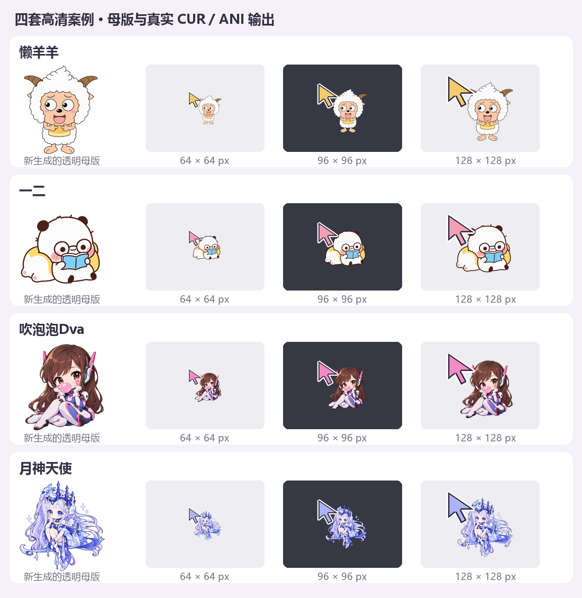
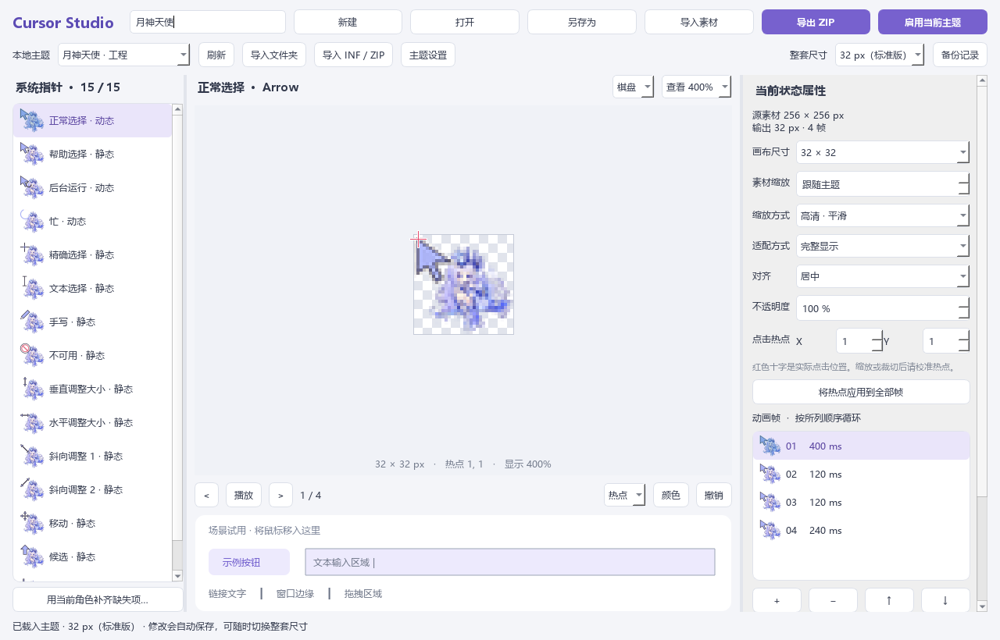

# Custom Cursor Studio

给 Windows 换一套你喜欢的鼠标指针，也能用自己的图片做一套。

这里有 **4 套可以直接用的主题**、一个帮你制作新主题的 **创作 skill**，以及一个可以亲手调整的 **中文可视化编辑器**。不用注册账号，不用连接服务器，也不需要付费 API。已有图片的编辑、预览和导出都在本机完成。

## 先看看，喜欢哪一套？



上图展示四套主题的画稿，以及实际导出光标的 64 / 96 / 128 像素效果。每套都包含正常选择、链接选择、忙碌、文本选择等 **15 种系统状态**；动态效果需要打开主题预览。

| 主题 | 打开这个文件夹 |
| --- | --- |
| 懒羊羊 | [懒羊羊](懒羊羊/) |
| 一二 | [一二](一二/) |
| 吹泡泡Dva | [吹泡泡Dva](吹泡泡Dva/) |
| 月神天使 | [月神天使](月神天使/) |

## 开发过程

做过不少 GitHub 项目之后，我发现很多作品虽然设计出来了，自己却不会经常去用。所以这次，我想做一款自己平时会一直用的东西。想来想去，突然发现：鼠标指针不就是我们每天都在用的吗？

项目最早参考的是 **“吹泡泡Dva”和“月神天使”** 两套主题，是朋友分享给我的。他可能是从 B 站找到的，具体来源我也不太了解。原文件里标注的作者是 **未奈minako**，这里保留这份署名，也感谢原作者的创作。它们是本项目的起点，并非本项目原创。

拿到这两套主题后，我先从文件里利用**REA**逆向梳理它们的工作方式：安装说明里的 INF 文件负责告诉 Windows“哪一个文件对应哪一种鼠标状态”；CUR 文件保存静态图像和真正点击的位置；ANI 文件则把多帧图像、播放顺序和每帧时长组合起来，让指针动起来。这个过程只读取和分析原始文件，不运行它们的安装脚本，也不改动原文件。

弄清这些原理后，才逐步做出了这个项目：先能读懂和预览现有主题，再能编辑图片、大小、点击位置与动画，最后把自己做的内容导出成 Windows 能识别的光标主题。后来又加入了懒羊羊、一二两套案例，以及可复用的创作 skill，希望大家既能直接用，也能做出自己愿意每天用的那一套。

想了解两套参考主题的具体解析结果，可以看 [参考主题对照报告](editor/evidence/reference-report.md)；素材说明见 [NOTICE.md](NOTICE.md)。

## 我该怎么用？

**我想马上换一套，就选现成主题；想做自己的，就调用创作 skill；想亲手调整，就打开编辑器。**

### 我想直接用一套现成的

1. 下载并完整解压这个项目。
2. 打开喜欢的主题文件夹，双击 **应用主题.cmd**。
3. 选择大小，查看预览，再点击 **应用所选大小**。

这个入口用 Windows 自带的 PowerShell 运行，不需要 Python、网络或管理员权限。四套现成主题提供 64 / 96 / 128 像素；想用更小的标准尺寸，可以进入编辑器调整。

想换回电脑自带的鼠标？双击项目根目录的 **取消自定义光标.cmd**，确认后恢复 Windows 默认白色指针和标准大小。

### 我想做一套自己的鼠标指针

把这个项目交给支持读取本地文件的 AI 助手，再复制下面这段话。把“小狐狸”换成自己的想法，也可以附上喜欢的图片。

```text
请调用 cursor-theme-creator skill，读取本仓库
SKILLS/cursor-theme-creator/SKILL.md，帮我制作一套“小狐狸”Windows 鼠标指针主题。
优先使用我提供的图片，放进独立的新文件夹，不覆盖现有主题。
请做好 15 种状态、可编辑工程和主题安装包，先让我看预览，不要自动启用。
```

技能在 [SKILLS/cursor-theme-creator](SKILLS/cursor-theme-creator/)。如果已经把它安装到助手的技能目录，也可以通过 `$cursor-theme-creator` 调用；仅下载仓库不会自动安装全局技能。

**skill 是给助手看的制作说明和工具入口。** 它会调用项目已有的制作能力，把素材做成真正的 CUR / ANI 光标。它本身不附带图像生成模型：用已有图片可以离线制作；从文字画出新图片，需要助手本身有图像生成能力。没有这个能力时，提供自己的图片就能继续。

<details>
<summary>我想直接用脚本制作</summary>

先启动一次编辑器，准备好 Python 环境，再在项目根目录运行：

```powershell
.\.venv\Scripts\python.exe SKILLS/cursor-theme-creator/scripts/create_theme.py --workspace . --name "我的狐狸" --image ".\素材\狐狸.png"
```

图片需要是真实透明的静态 PNG，至少 256 像素，建议使用原生 1024 像素以上的画稿。默认生成独立的 `我的狐狸/` 文件夹，包含可编辑工程、15 种状态、64 / 96 / 128 像素资源、INF 安装文件、说明和 ZIP。已有同名文件夹时会停止，不覆盖原内容。

这也是供其他工具复用的创作接口。更详细的输入和输出约定见 [技能说明](SKILLS/cursor-theme-creator/SKILL.md)。

</details>

### 我想自己调大小、图片和动画

在项目根目录双击 **启动编辑器.cmd**。左边选状态，中间看效果，右边调整素材、大小、点击位置和动画帧。



- **选主题：** 顶部“本地主题”可以载入四套案例。以后加入新主题文件夹，点“刷新”即可；放在其他位置的主题用“导入文件夹”打开。
- **改大小：** 顶部“整套尺寸”调整所有状态，右侧“画布尺寸”只调整当前状态。首次启动默认是 **32 px（标准版）**，之后打开已保存的工程会保留它的尺寸。“查看 100% / 200% / 400%”只放大编辑画面。
- **改点击位置：** 热点就是图片上真正点下去的位置。可以拖动十字标记，也可以输入 X / Y；导出和启用都会保留这个位置。
- **做动画：** 导入多帧，调整顺序和每帧时长，播放检查效果。预览按各帧实际时长播放。
- **保存和使用：** 修改后会自动保存，切换主题前也会保存，不需要反复点保存按钮。做好后点“启用当前主题”并确认，或者“导出 ZIP”发给别人。“另存为”用来留一份副本。

放大时会从现有高分辨率素材重新输出；如果原图很小，软件不能凭空补出细节，需要换一张更清楚的图片。每套主题里的 **编辑主题.cmd** 可以直接打开对应工程，**放大与导出.cmd** 可以单独预览、调整尺寸和导出。

## 我的电脑需要准备什么？

使用现成主题，只需要 Windows 10 / 11，并保留完整的项目文件夹。

使用编辑器或制作新主题，需要 **Python 3.11+**，建议 3.11～3.13。首次启动编辑器会自动准备运行环境、安装依赖，这一步需要联网；准备好以后，使用本地素材进行编辑和导出可以离线完成。目前没有免 Python 的独立 EXE。

启动失败时窗口会显示错误，日志保存在 `%LOCALAPPDATA%/CustomCursorStudio/logs`。手动安装方法见 [开发指南](CONTRIBUTING.md)。

## 我想发给朋友，或者换一台电脑用

只分享成品，发送主题 `exports/` 里的 ZIP 即可，里面有光标文件、INF 和安装说明。想让朋友继续编辑，就保留整个项目和对应主题的工程、素材文件夹。

启动脚本按自身位置寻找文件，工程素材使用相对路径，**不依赖原作者的盘符或用户名**。项目已在包含中文和空格的新路径下验证主题读取。分享源码时不用带上本机的 `.venv`、缓存或日志；对方首次打开编辑器会准备自己的环境。

启用时，Windows 需要记录本机光标文件的实际位置。程序会在接收者电脑上重新生成这些安装路径，不需要复制原作者的系统设置或备份。

## 开源协议

程序源码、脚本与文档采用 [MIT 协议](LICENSE)。欢迎使用、修改和贡献代码，分发时请保留协议与版权声明。

四套案例涉及的第三方角色及参考素材不在 MIT 授权范围内，具体见 [素材与许可说明](NOTICE.md)。
